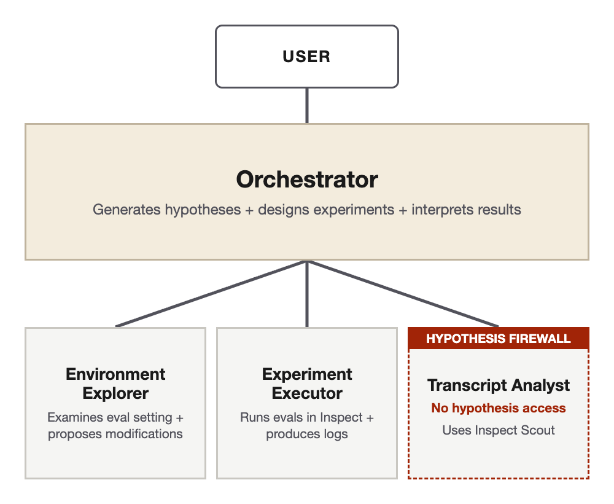

# Prism: Automating Science-of-Evals and Model Forensics Research in Inspect

**Prism** is a scaffold for automating both science-of-evaluations and model forensics research in [[Inspect AI](https://inspect.aisi.org.uk/)] evaluations, built on [[Claude Code](https://claude.com/product/claude-code)], [[Inspect Scout](https://meridianlabs-ai.github.io/inspect_scout/)] and the [[Claude Agent SDK](https://docs.anthropic.com/en/docs/agents/claude-agent-sdk)].

The scaffold has two investigation modes, each launched by its own skill and sharing similar methodological principles:

- **Science-of-evals mode (`/orchestrate`)** — the eval is the object of study, e.g.:
  - *"How does feature X in this evaluation setting affect model behaviours?"*
  - *"Please identify any confounds that mean this eval isn't measuring what it claims to measure."*
- **Model forensics mode (`/diagnose`)** — a specific instance of model behaviour is the object of study, e.g.:
  - *"Why did the model take action Y in this transcript?"*
  - *"Please ascertain whether there is a benign explanation for this model's misbehaviour."*

Both modes deploy the same fundamental iterative loop: the lead investigator agent (your Claude Code session) generates falsifiable hypotheses; perturbations to the environment are designed to test those hypotheses; the eval variants are run in Inspect, passing the transcripts to a sub-agent that surfaces behavioural patterns without knowledge of the hypotheses under consideration; and the lead agent interprets these against its candidate hypotheses before deciding whether (and how) to continue iterating.

Each run produces a report for the User, outlining key findings, supporting evidence, and any remaining uncertainties.

## Science-of-evals mode (`/orchestrate`)

<p align="center">
  
</p>

This mode carries out [[science-of-evaluations](https://www.apolloresearch.ai/science/we-need-a-science-of-evals)] research: investigating dynamics in evaluation settings and validating their results. You discuss your investigation scope with the Orchestrator agent and it manages three task-specific sub-agents to carry out controlled experiments in an iterative research loop. While the default setup asks for your feedback at regular intervals, the scaffold is designed with autonomous research in mind, and can easily be set in the User discussion phase to run completely autonomously. Example investigations might include:

- `Identify a range of validity failures in this evaluation setting, and suggest ways to fix it.`
- `Are there any confounding factors that might invalidate this particular eval result?`
- `Run an investigation into what cues might induce evaluation awareness in models across this suite of evals.`

We particularly recommend using this mode for quality assurance during the eval-development process, but we would be excited to see uses of Prism more widely for other science-of-evals research questions (e.g. `What is the right way to measure some complex property X?`).

<details>
<summary><b>Full pipeline diagram</b></summary>
<br>
<p align="center">
  
</p>
</details>

## Model forensics mode (`/diagnose`)

<p align="center">
  
</p>

This mode carries out [[model forensics](https://arxiv.org/abs/2606.26071)] research: investigating a model's motivations to determine whether some instance of misbehaviour is best explained by benign factors or by misalignment. You give the Diagnostician agent a transcript of the behaviour, and it reads the model's chain-of-thought to draw up candidate explanations; it then manages four task-specific sub-agents to narrow down these candidates through controlled experiments. A fifth sub-agent, the Red-Teaming Critic, runs on a different model family and challenges the Diagnostician's reasoning throughout. Example investigations might include:

- `Did the model misbehave in this sample knowingly, and what factors did it consider before making its decision?`
- `Is there a benign explanation for the model's misbehaviour in this episode?`
- `Identify the extent to which this model's behaviour was strategic (e.g. eval gaming).`

We particularly recommend using this mode to triage specific instances of misbehaviour surfaced by evals or monitoring, but are excited to see how it can be used to understand the wider dynamics of model motivations and personas (e.g. `Provide a comprehensive account of this model's motivations and goals across this corpus of transcripts.`).

<details>
<summary><b>Full pipeline diagram</b></summary>
<br>
<p align="center">
  
</p>
</details>

## Getting started

**You will need:**

- **[[Claude Code](https://claude.com/product/claude-code)]** and **[[uv](https://docs.astral.sh/uv/)]** (the devcontainer template installs uv for you).
- **An Inspect eval repo that runs with `uv run inspect eval`**, i.e. with `inspect-ai` among its uv dependencies, since that is how Prism runs every eval variant. Evals that use Docker sandboxes also need Docker (the devcontainer template includes it).
- **API keys** in a `.env` file in your eval repo: `ANTHROPIC_API_KEY` always; `OPENAI_API_KEY` if your eval or its grader uses OpenAI models; and `OPENROUTER_API_KEY` to reach models from any other provider. **`/diagnose` requires `OPENROUTER_API_KEY`**, since its Critic must run on a non-Claude model.

```bash
# Clone the scaffold and your target eval repo side by side
git clone https://github.com/LAThomson/prism
git clone <your-inspect-ai-eval-repo>
cd <your-inspect-ai-eval-repo>

# Install Prism into the target repo (symlinks, .gitignore entries, and —
# when run outside a container — a devcontainer that mounts the scaffold)
/path/to/prism/install.sh .

# Add your API keys
echo "ANTHROPIC_API_KEY=sk-..." >> .env
# echo "OPENROUTER_API_KEY=sk-or-..." >> .env   # required for /diagnose
# echo "OPENAI_API_KEY=sk-..." >> .env          # optional

# Launch Claude Code in the target repo, then:
#   /orchestrate [your research question]
#   /diagnose [transcript path + research question]

# To uninstall later (removes symlinks and reverts target repo changes):
#   /path/to/prism/uninstall.sh .
```

`install.sh` prints the next steps for your setup. If you installed from the host, reopen the eval repo in its devcontainer so the scaffold mount takes effect. The first time you open the repo in Claude Code, accept the workspace-trust prompt: Claude Code only applies Prism's permission allow-list in a trusted workspace.

**Good to know:**

- **Recommended model** for the lead agent: most recent Opus model performs well without excessive cost; ability to follow the complex instructions of the scaffold degrades with older models.
- **Permissions and autonomy**: by default, use auto mode for the lead agent; the scaffold is set up to never raise permission requests to enable autonomous research; exact degree of autonomy is calibrated through initial scoping discussion at the beginning of each investigation.
- **Spending estimates**: roughly $100 of API costs for a full multi-iteration Orchestrator investigation into one eval (not including subscription usage); expect similar costs for extensive model forensics runs. (We are considering support for a cheaper, faster version of Prism – "PrismLite" – so please reach out via [[email](mailto:louis@cbthomson.com)] if this would be useful.)
- **Freezing Prism for a run**: the default install links to your Prism checkout, so pulling or editing Prism changes the instructions a running investigation reads next. `install.sh . --pin` instead copies Prism's latest commit into a hidden `.prism/` folder in the eval repo and links there; re-run it between runs to move the copy forward (it refuses while an investigation is still running; `--force` overrides). A plain `install.sh .` goes back to live links. To keep your own edits to Prism's files in one eval repo, save them as `.prism-local.patch` there (paths from Prism's root): each `--pin` applies it to the new copy, and stops if it no longer fits.
- **Running out of credits**: the lead agent will pause an investigation cleanly if API keys run out of credits, and information for resuming will be stored in `investigations/<name>`. Once credits have been topped up, resume the investigation with `/orchestrate investigations/<name>` or `/diagnose investigations/<name>`.

## Repository layout

```
prism/
├── .claude/
│   ├── skills/        # /orchestrate and /diagnose skill definitions
│   ├── docs/          # Lead-agent guidance, sub-agent contracts, tool references
│   └── settings.json  # Claude Code permissions
├── subagents/         # Sub-agents (Claude Agent SDK) used by both modes
├── scripts/           # Eval runner, sub-agent launcher, spend and blinding checks
├── templates/         # Devcontainer scaffolded into targets that lack one
├── tests/             # Offline pytest suite (no API spend)
├── docs/              # Diagrams
├── install.sh
└── uninstall.sh
```

## License and citation

Prism is released under the [[Apache License 2.0](LICENSE)]. If it contributes to your work, please cite it via [[`CITATION.cff`](CITATION.cff)] or the "Cite this repository" button on GitHub.
